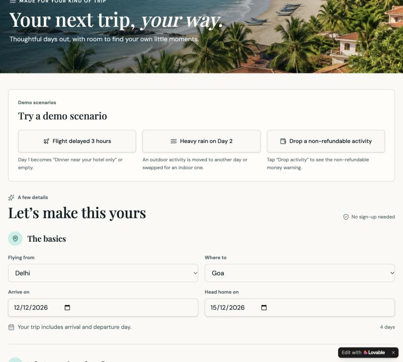
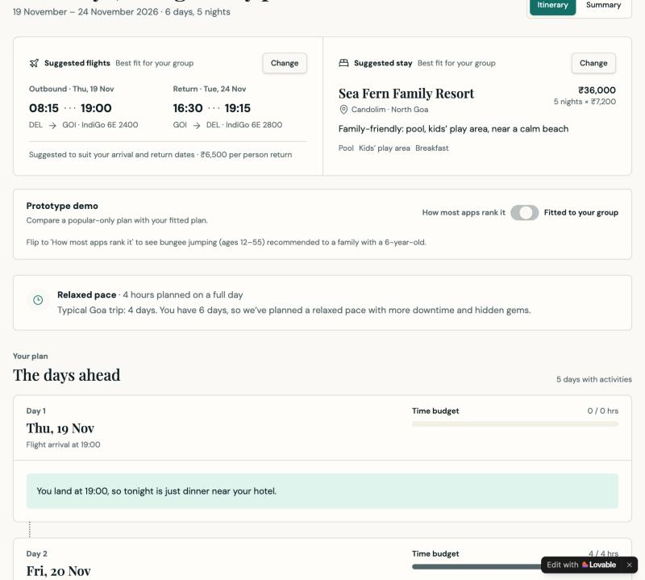
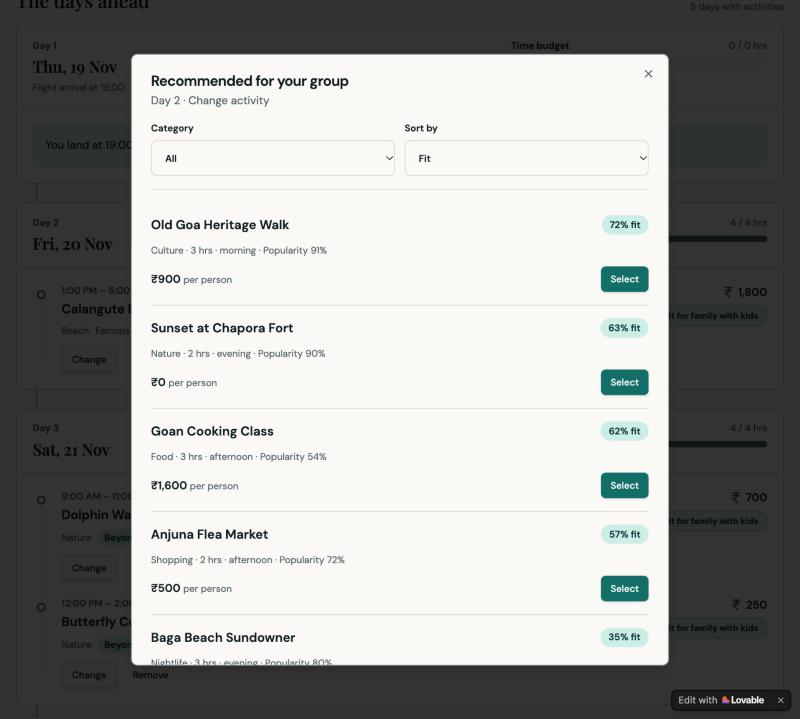
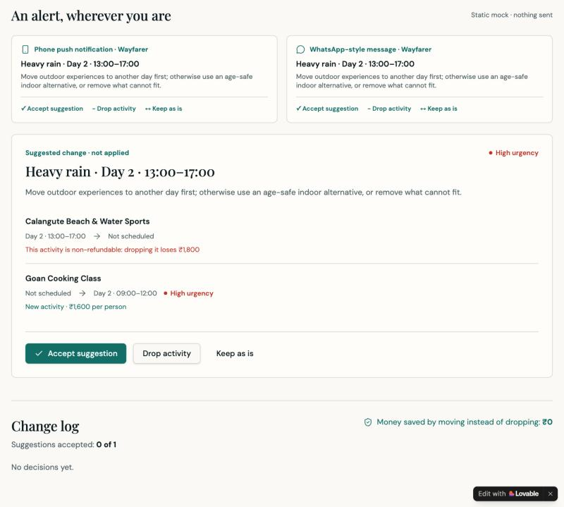

# Prototype guide: AI-powered personalized recommendations for a travel booking app

**Live prototype:** https://safe-and-scenic-days.lovable.app

This guide is for someone opening the prototype for the first time. It explains what the prototype is, how to try it in about two minutes, what it covers and what it does not.

Prepared by Sharad Dubey as part of a product case study.

---

## Contents

1. [What this is](#1-what-this-is)
2. [Try it in two minutes](#2-try-it-in-two-minutes)
3. [Screen by screen](#3-screen-by-screen)
4. [How the recommendations work](#4-how-the-recommendations-work)
5. [Scope](#5-scope)
6. [Limitations](#6-limitations)
7. [What a full product would add](#7-what-a-full-product-would-add)
8. [How it was built](#8-how-it-was-built)
9. [Questions people ask](#9-questions-people-ask)

---

## 1. What this is

A working prototype of a trip planner that recommends a day-by-day plan fitted to **who is travelling, for how long, and when they land**.

Most travel apps rank activities by overall popularity, so a family with a young child and a solo traveller see the same list. This prototype ranks by fit for the group instead, blocks activities the group cannot do, sizes each day to the group, and suggests a new plan when a flight is late or it rains.

It runs in the browser on mock data. No sign-up is needed, and nothing you do in it books or charges anything.

## 2. Try it in two minutes

Open the [live prototype](https://safe-and-scenic-days.lovable.app). Near the top is a card called **Try a demo scenario** with three buttons. Each one fills in a sample trip and takes you straight to the result.

The sample trip is a family of three (two adults and a child aged 5 to 11) flying from Delhi to Goa for six days.

| Step | What to click | What you should see |
|---|---|---|
| 1 | **Flight delayed 3 hours** | The landing time moves from 19:00 to 22:00, and day 1 becomes dinner near the hotel only. |
| 2 | Go back to the start, then **Heavy rain on Day 2** | The outdoor activity that afternoon is flagged and an indoor one is suggested. The activity is non-refundable, so a warning shows how much money dropping it would lose. |
| 3 | Click **Itinerary** in the top bar | The full six-day plan, with suggested flights and stay at the top. |
| 4 | On the itinerary, flip the switch to **How most apps rank it** | The plan re-ranks by popularity. Bungee jumping, which has an age limit of 12 to 55, now appears for a family with a young child. Flip it back and bungee is hidden again. |
| 5 | Click **Change** on any activity | A list titled "Recommended for your group", sorted by fit, with unsuitable activities shown at the bottom as hidden and not selectable. |

To plan your own trip, scroll past the demo card and fill in the form.

## 3. Screen by screen

### Trip form

You enter where you are flying from, the destination, arrival and departure dates, the number of adults, an age band for each child, and your interests. The traveller type (solo, couple, or family with kids) is worked out from who you add.

### Itinerary

- **Suggested flights and suggested stay.** The app picks the option that fits the group best. **Change** opens the alternatives, each with a fit score, a price and a one-line reason.
- **Pace banner.** Each city has a typical trip length. A longer trip gets a relaxed pace with fewer hours per day, and a shorter trip gets a packed one.
- **Day-by-day plan.** Each day has a time budget. The first day starts after the flight lands, and the last day ends before the return flight.
- **Beyond the famous spots.** On longer trips, later days include lesser-known activities.
- **Hidden for your group.** Activities that a traveller is too young or too old for are listed here with the reason.
- **Prototype demo switch.** "How most apps rank it" shows the same trip ranked by popularity alone, for comparison. A real product would not show this switch.

### Activity picker

**Change**, **Remove** and **Add to day** let you edit the plan. The picker lists activities that fit the time slot, sorted by fit for your group. You can filter by category and sort by fit, price or popularity.

### Trip summary

Shows the flights, the stay, every activity and the total price, with a **Book trip** button. Booking is simulated.

### Live trip

After a simulated booking, the live trip screen shows one day at a time. A panel labelled **Simulate a disruption** lets you trigger a flight delay, heavy rain, or a crowd at an activity. The app then suggests a new plan and waits for you to choose **Accept suggestion**, **Drop activity** or **Keep as is**. It never changes the plan on its own.

The suggestion shows how urgent the change is, what moves, and whether any money is lost. A change log at the bottom records each decision.

## 4. How the recommendations work

The prototype follows the same steps a full product would, in a simplified form.

1. **Safety check.** Any activity with an age limit that a traveller falls outside is removed first.
2. **Fit score.** Each remaining activity gets a score:

   `Fit = 0.6 × group fit + 0.3 × interest match + 0.1 × popularity`

   - *Group fit* carries the most weight because it is the only signal that reflects who is travelling.
   - *Interest match* gets half of that, since stated interests alone are a narrow signal.
   - *Popularity* is a tie-breaker. It can add at most 0.10, so a popular activity cannot outrank a well-fitting one.
3. **Pacing.** Hours per full day start at 8 for a solo traveller, 7 for a couple and 6 for a family. They go down by one for each day beyond the city's typical trip length, and up by one for each day short of it.
4. **Day building.** Activities are placed into days in order of fit, within each day's hours.
5. **Replanning.** When a disruption is triggered, the app works out which activities no longer fit and suggests the change that loses the least.

The typical trip lengths used are 4 days for Goa, 3 for Jaipur and 5 for Manali.

## 5. Scope

| Area | What the prototype covers |
|---|---|
| Destinations | Goa, Jaipur and Manali |
| Departure cities | Delhi, Mumbai, Bengaluru and Kolkata |
| Traveller types | Solo, couple, and family with children |
| Planning | Suggested flights and stay, fit-based activity ranking, pacing by trip length, age-limit safety check, editing the plan |
| During the trip | Replanning for a flight delay and heavy rain, with refund-aware suggestions. A crowd trigger is included and labelled as a later phase. |
| Comparison | A switch that shows the same trip ranked by popularity alone |

## 6. Limitations

These are deliberate simplifications for a prototype. Each one is something a full product would replace.

- **All data is mock data.** Flights, hotels, activities, prices, ratings and age limits are made up for the demonstration. They are plausible but not real listings.
- **Fit scores are simulated.** The group-fit number for each activity is a fixed value in the mock data. The three weights in the formula are fixed starting values. Nothing is learned from user behaviour.
- **No real bookings or payments.** "Book trip" only shows a confirmation.
- **Disruptions are triggered by buttons.** There is no connection to live flight, weather or traffic data.
- **No accounts.** There is no login, and a plan is not saved between visits.
- **Three cities only**, with a small set of activities in each. The Goa family trip is the most thoroughly tested path; other combinations have been exercised less.
- **Notifications are mock-ups.** The push and WhatsApp previews are static images of what an alert would look like. Nothing is sent.
- **One language and one currency.** English and Indian rupees.
- **Not tested for accessibility or on every device.** It works on desktop and mobile browsers but has not been through formal testing.

## 7. What a full product would add

- A ranking model trained on what similar groups booked, kept and removed, replacing the fixed weights.
- A language model that reads listings and reviews to extract age and health limits and to score how well an activity suits each kind of group.
- Live data for flight status, weather, travel time between stops and opening hours.
- Real inventory and booking through travel partners.
- Crowd and waiting-time data from activity operators.
- More cities, then international trips.

## 8. How it was built

The prototype was built on [Lovable](https://lovable.dev), an AI app builder, by describing each screen and rule in plain-language prompts. It is a front-end web app with its data held in the app itself. There is no server or database.

## 9. Questions people ask

**Is this a real booking app?**
No. It demonstrates how the recommendations would behave. Nothing is booked or charged.

**Why can I see a "How most apps rank it" switch?**
It is there so you can compare the fitted plan with a popularity-ranked one for the same trip. It is a demonstration aid.

**Why does day 1 show only dinner?**
The sample flight lands at 19:00. The plan allows two hours to reach the hotel, which leaves no time for an activity that day.

**Why is bungee jumping hidden?**
The listing has an age limit of 12 to 55, and the sample trip includes a child aged 5 to 11.

**Why does rain swap the activity and not move it to another day?**
The app looks for a free slot on another day first. In the sample trip no other day has four free hours, so it suggests an indoor activity instead and shows the cost of dropping the original.

**Are the fit percentages real?**
They are calculated by the formula above from mock inputs. They show how the ranking behaves, not measured results.
